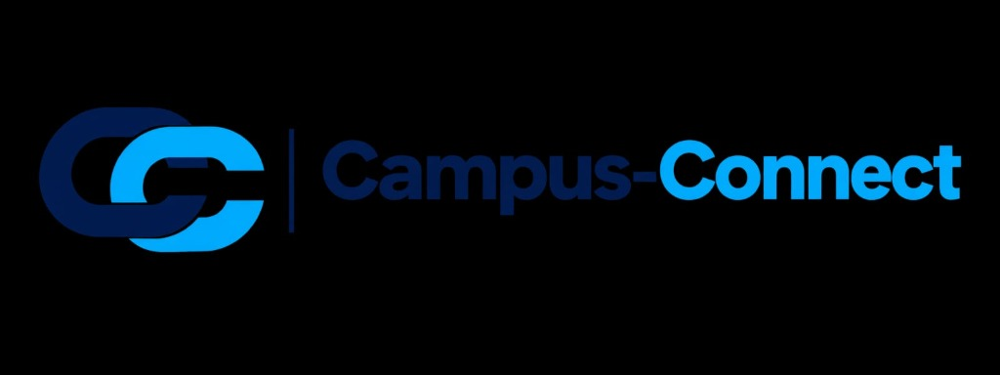

# Campus Connect 🎓

> A photo album website for every cultural, tech, and sports event at IIIT Lucknow.



## About

Campus Connect is a student-made photo album website for IIIT Lucknow. Cultural, tech, and sports events live in one place, so students can revisit past events and see new ones.

## Features

- 📸 **Browse Photos** — Event photos sorted by category and year
- 💬 **Join In** — Leave comments on events (saved locally in your browser)
- ⬆️ **Upload Your Memory** — Share photos through a Google Form
- 🔍 **Filter the Gallery** — Narrow photos by category, year, and sort order
- 📱 **Responsive** — Works on phones, tablets, and desktops

## Pages

| Page | Description |
|------|-------------|
| **Home** | Hero banner, latest events, upload CTA, how it works |
| **Events** | Browse all events with category filter pills |
| **Gallery** | Full photo gallery with category, year, and sort filters |
| **About Us** | About text, how it works, tech stack, team cards |

## Tech Stack

- **HTML5** — Semantic markup
- **CSS3 + Bootstrap 5** — Styling, grid, and responsiveness
- **JavaScript** — Logic, filtering, sorting, validation
- **React.js** — Component-based architecture with `useState`
- **JSON** — Event data storage (no backend)
- **LocalStorage** — Browser-side comment persistence

## Getting Started

```bash
# Clone the repo
git clone https://github.com/your-org/campus-connect.git
cd campus-connect

# Install dependencies
npm install

# Start dev server
npm run dev

# Build for production
npm run build
```

## Project Structure

```
Campus-Connect/
├── public/
│   └── images/
│       ├── logo.jpg
│       └── events/          # Event photo folders
├── src/
│   ├── components/
│   │   ├── Navbar.jsx
│   │   ├── Footer.jsx
│   │   ├── EventCard.jsx
│   │   ├── Lightbox.jsx
│   │   └── CommentBox.jsx
│   ├── pages/
│   │   ├── Home.jsx
│   │   ├── Events.jsx
│   │   ├── EventDetail.jsx
│   │   ├── Gallery.jsx
│   │   └── About.jsx
│   ├── data/
│   │   └── events.json
│   ├── App.jsx
│   ├── main.jsx
│   └── index.css
├── index.html
├── package.json
└── README.md
```

## Team

| Role | Responsibility |
|------|---------------|
| 1. UI/UX Designer | Colors, fonts, logo, wireframes, global CSS |
| 2. Navbar & Footer Dev | Sticky navbar, page switching, footer |
| 3. Home Page Dev | Banner, latest events, upload button |
| 4. About Us Dev | About text, how it works, team cards |
| 5. Events Page Dev | Event cards grid, category pills |
| 6. Event Detail Dev | Detail view, photo lightbox, YouTube embed |
| 7. Gallery Dev | Photo grid, category/year/sort filters |
| 8. Comments Dev | Comment box, validation, React state |
| 9. Data & Content Manager | events.json, photo folders, Google Form |
| 10. Git Manager & Deployer | Repo, merging, testing, deployment |

## How Photos Go Live

1. **Share** — Student fills the Google Form
2. **Review** — Admins check the photo
3. **Add** — Photo goes into `images/` and `events.json`
4. **Push** — Code pushed to GitHub
5. **Live** — Hosting auto-updates the site

> Nothing goes live without an admin saying yes.

## License

Built with ❤️ by IIIT Lucknow students.
